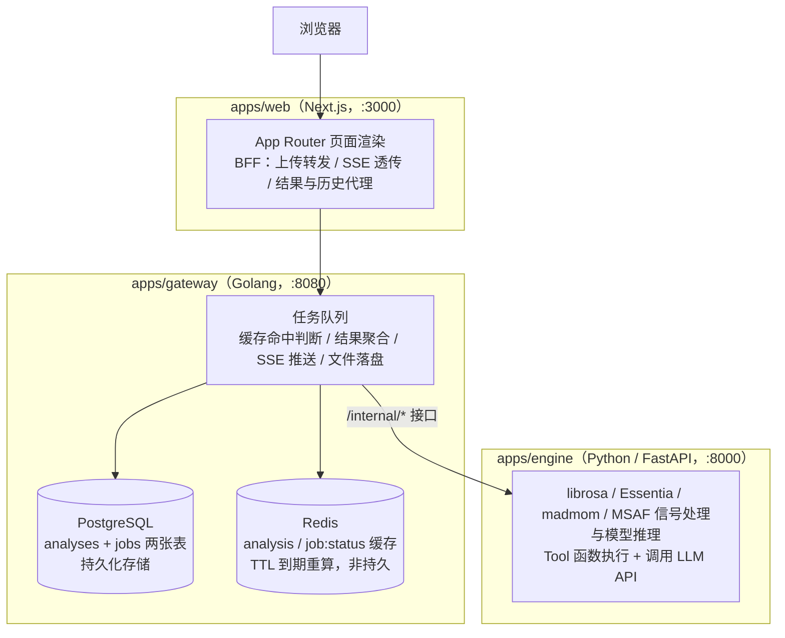
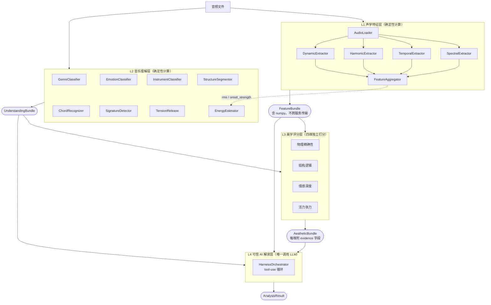

# 第 1 章 绪论

## 1.1 项目背景

歌德在《浮士德》中写下："你真美啊，请停一停。"可美从不为任何人驻足。在我生命中，每当我感到此刻很美，便同时清醒地意识到，它已经逝去，回忆将成为我与它重逢的唯一方式。直到某一天，我察觉到音乐可以让美在时间中反复重生——它使美不再只属于某个不可复得的瞬间，而能在每一次聆听中重新降临。人生中那些逝去的美，像散落在时间里的珍珠；而音乐，是那根可以反复将它们串起的线。

从古典到摇滚，我每天都会被音乐的美击中，一次又一次地爱上它。某天清晨醒来，我意识到：把音乐和计算机科学结合起来，这件事对我有强烈的诱惑，我无法抵挡。

我本科读的是光电工程，2014 年毕业；硕士读的是生物医学工程，2017 年毕业。2016 年，我开始自学计算机科学，从外企实习起步，至今已有 10 年多后端开发和软件开发经验，有互联网公司、外企和 AI 公司的工作经历。

AI 降低了学习新领域的门槛。用计算机工程的方式做音乐，从遥不可及变成了可以尝试的事情。音乐是音乐家的领域，音乐科技却不完全是。音乐家有直觉，但怎么把一次性的创作变成可以反复试验、不断迭代的流程？怎么把"这一段听起来更好"这种主观感受，变成软件能理解、能计算的东西？把直觉变成能反复运行的系统，这件事需要既能理解音乐、又能把问题拆成工程去实现的人。

于是我开始重温数字信号处理，自学音频特征工程，也重新开始练习钢琴。学到一定程度，我想做一个完整的项目把这些知识串起来，于是有了 Computable Beauty 这个项目。

我把 Computable Beauty 的演示视频发到小红书之后，有人私信我，说自己也对音乐科技感兴趣，问有没有学习资料可以推荐。我的学习方式是边做边学，遇到不懂的就问 AI。所以我决定把这个项目从头到尾梳理一遍，写成一系列文章，希望能和同样对音乐科技感兴趣的人一起交流。

## 1.2 确认方向

先看一下音乐科技这个行业有哪些方向。按技术应用分层，大致如图 1-1 所示。

![[file-20261013180216208.png]]

<em>图 1-1 音乐科技行业按技术应用分层</em>

图里从下到上分五层。最底下是基础设施层，包括 DSP 信号处理、音频编解码、声学建模、MIDI 协议等。往上是引擎层，包括音乐 AI 模型、音频特征工程、实时处理引擎等。再往上是工具层，包括 DAW 宿主软件、音频插件、采样库工具、音乐 API 服务、音频分析工具、云端音频处理等，它们把引擎层的能力包装成可以直接拿来用的工具。再往上是产品层，包括 AI 音乐生成、音乐推荐、影视游戏音效、采样库平台等面向用户的产品。最上面是这些产品落地的真实场景：流媒体、游戏、影视。

换一个角度，看每个方向对音乐能力和工程能力各有多高的要求，如图 1-2 所示。

![[file-20261013180216175.png]]

<em>图 1-2 音乐科技各细分方向的音乐能力与工程难度要求</em>

图 1-2 的横轴是对音乐能力的要求，纵轴是工程难度，颜色表示对乐理的要求。音频 AI 工程、音乐推荐系统、音频云服务、采样库工具开发、版权识别这些方向，基础乐理就够用。AI 创作辅助工具、音频分析工具、游戏音频中间件、乐谱识别和 MIDI 处理，需要比较深入地掌握乐理。合成器插件开发、音色设计、混音母带工具、影视作曲工具，则需要多年的演奏经验和听音训练。

我在光电工程和生物医学工程专业都学过信号处理，10 年多后端开发和软件开发经历让我具备了一定的计算机工程能力。乐理和演奏是我正在补的部分。对照这两张图，我选择了 MIR 算法的工程化落地这个方向。

MIR 是 Music Information Retrieval 的缩写，中文叫音乐信息检索，简单说就是让计算机从音频里自动"听"出信息。这些信息可以分成几类。最基础的是音乐本身的要素：这首歌每分钟多少拍，拍点落在哪里，是什么调，每一段用的是什么和弦，主旋律是哪几个音。再往上是需要综合判断的语义信息：它属于什么风格，听起来是欢快还是忧伤，用了钢琴、吉他还是弦乐，哪里是前奏、哪里是主歌、哪里是副歌。还有一类是把这些能力用到具体场景里：听歌识曲，靠的是从一小段录音里提取"音频指纹"去曲库里匹配；把一首歌里的人声和伴奏分开，叫音源分离；把录音自动转写成乐谱，叫自动扒谱；音乐平台判断"喜欢这首歌的人可能还喜欢哪首"，背后也有 MIR 提取的特征在起作用。

Computable Beauty 用到的主要是前两类：节拍、调性、和弦属于第一类，风格、情绪、乐器、段落结构属于第二类。在这些结果之上，它再往前走了一步，尝试回答"这首歌美在哪里"。

## 1.3 产品初衷

我很喜欢 Yoshiki 创作的《Art of Life》。有段时间，我常思考：这首曲子为什么这么打动我？于是冒出一个问题：音乐的美，能不能被计算？

真正打动人的音乐往往同时具备好几层：精确的节奏结构（物理层）；严谨考究的编曲逻辑（结构层）；直面情绪起伏的深度（情感层）；张弛分明的能量起伏（活力层）。于是，我计划做一个项目，把这四个维度的直觉，翻译成可以计算的指标。

但真正开发后，我意识到音乐的美不能被完全量化。这套评分有一个确定存在的偏差：它隐含地奖励全编制编曲和强烈的动态对比，对安静、独奏、和声色彩克制的曲目，分数会系统性地偏低。巴洛克音乐的和声语汇本身是克制的，但它很美——巴赫的《G 弦上的咏叹调》在活力张力这个维度上只得到 23.3 分。

音高之间的数理关系，只能约束音程的骨架——同样的音高序列，用不同的节奏、力度、音色、和声去呈现，审美效果完全不一样。数理关系只是音乐之美的必要条件之一，美发生在符号层和信号层这些骨架之外的维度里。 克制是一种主动选择，还是被动放弃。在任何艺术领域，都只有具体的人才能感知出来。

但换个角度，这个系统可以用来辅助 AI 生成音乐。以影视配乐为例，影视圈有 temp track 的惯例：制作方先找一首感觉对的曲子给作曲家当参照，意思是"大概要这种感觉"。如果用 AI 生成配乐，可以先用 Computable Beauty 把参照曲目分析一遍，得到一份结构化的数据，以及基于这份数据生成的 AI 解读。再把这段解读整理一下，作为 Suno 这类 AI 音乐生成工具的 Prompt。这样的 Prompt，比直接写"悲伤又克制"要精确，因为 AI 解读里的每一句话都对应着具体的维度和数字，不是凭空堆出来的形容词。

以《Forever Love》作为参照曲目，Computable Beauty 生成的 AI 解读是这样的：

> 最突出的是活力张力，得分89.58分（百分制，表示能量推动与强弱对比尤为显著），其爆发事件密度为278.93（每分钟的能量突发事件数量），显示出持续而密集的推动感。物理精确性为77.24分（百分制，反映声音控制的稳定度与层次），结构逻辑为75.62分（百分制，反映材料组织的清晰度），均高于情感深度的63.18分（百分制，反映可测情绪变化的幅度与转折），说明作品更突出声音张力、节奏稳定和结构组织。
>
> **物理精确性 (77)** 物理精确性达到77.24分（百分制，反映演奏与声音控制的综合贴合度）。作品的动态范围为24.68分贝（响度从弱到强的跨度，跨度较大意味着层次更清楚），频率分布的标准差为10.56分贝（不同频段能量离散程度，数值适中说明音色分布有辨识度但并非完全均匀），速度波动指标为0.03（相对波动值，越低表示拍速越稳定），因此整体呈现出稳定拍点与明确动态层次；其中频率平衡仍主要反映这套弦乐与钢琴织体的频段配置，不应单独等同于演奏质量。
>
> **结构逻辑 (76)** 结构逻辑达到75.62分（百分制，反映材料组织与段落衔接的清晰度）。全曲识别出16.0个不同和弦（和声材料的种类数量），段落长度均衡比为0.41（0到1的比例，越接近1表示各段时长越均匀），结构覆盖度为0.84（0到1的比例，越高表示可被段落与转折模型解释的部分越多）。这表明作品拥有足够明确的和声材料和较高的整体结构可解释度，同时段落时长并不平均，形成了有意的长短对比。
>
> **情感深度 (63)** 情感深度达到63.18分（百分制，反映情绪轨迹中可测得的变化幅度与转折）。情绪唤醒度的标准差为0.05（唤醒度波动的离散程度，说明总体变化较收束），正负情绪极性转换率为0.02（每个分析单位中的转换比例，数值较低表示情绪方向大多保持连续），全曲出现8.0次极性转换（可辨认的正负情绪方向切换次数），而愉悦度跨度为0.67（轨迹最高值与最低值之差，数值越大表示情绪方向移动越明显）。因此，这首被标为忧郁、感伤的舞台与影视风格作品，主要依靠少量但幅度可观的情绪转向推进；较低的唤醒度离散度也意味着这种变化更像持续的情绪流动，而非频繁剧烈的情绪跳变。
>
> **活力张力 (90)** 活力张力达到89.58分（百分制，反映能量事件密度与强弱对比所形成的推动感）。爆发事件密度为278.93（每分钟的起音或能量突发事件数量，数值高表示推动性事件非常密集），动态对比度为0.26（0到1的强弱反差指标，数值越高表示力度变化越明显）。这两个指标共同指向持续而密集的能量活动；不过活力张力的测量会结构性偏向高动态、全编制的声音，因此这里的高分首先说明其可测得的能量与反差强，不能单独替代对音乐表现力的整体判断。

这段解读并不完美，结构逻辑那一段就有两处读错了数字的含义。"结构覆盖度 0.84"的实际含义是，识别出的和弦里有 84% 属于主、下属、属这三类基本和声功能（第 5 章会讲），模型却把它解释成"可被段落与转折模型解释的部分"。"段落长度均衡比 0.41"是段落时长的标准差除以均值，数值越小说明段落越均匀，模型却写成了"越接近 1 越均匀"，方向正好说反。这说明光靠提示词约束，还挡不住大模型误读数字的含义，第 6 章会专门讨论这个问题。

从解读里挑出一部分信息，改写成 Suno 的 Prompt，可以是这样：

> 一首由钢琴和弦乐主奏的作品。节奏推动感极强，几乎每小节都有清晰的能量爆发，乐句之间的强弱对比明显；拍速稳定扎实，几乎没有晃动，响度从最弱到最强的跨度拉得很开，弱奏和强奏的层次区分很清楚，各声部音色分布有辨识度，不是完全均匀的一团；和声材料丰富多变，不停切换不同和弦色彩，段落长度长短错落，但段落走向和转折大多在可预期的结构范围内；整体情绪基调偏忧郁感伤，大部分时间情绪走向平稳延续，只在少数几个地方出现幅度明显的转折，每一次的情绪落差都不小，不是那种频繁的情绪跳跃。

这就是 Computable Beauty 的设计初衷：承认美不能被完全计算，但还是去做这个产品，因为它有可以想象的应用：用结构化的"审美指纹"替代模糊的文字 Prompt，辅助 AI 生成音乐。

## 1.4 系统架构

先简单介绍一下 Computable Beauty 的整体架构，如图 1-3 所示。这部分属于通用的工程内容，本文只交代各部分的分工，不展开细节。

<em>图 1-3 Computable Beauty 的三服务架构</em>

整个系统由三个服务组成：前端 Web、网关 Gateway、计算引擎 Engine。

浏览器只跟 Web（Next.js）通信。Web 不做任何计算，也不能绕过 Gateway 直接访问 Engine。它里面的 BFF（Backend for Frontend，专门服务前端的后端）没有业务逻辑，对外暴露的几个路由都只是转发：`/api/analyze` 把上传的文件转给 Gateway 的 `POST /api/jobs`，`/api/progress` 把 Gateway 推来的进度事件透传给浏览器，其余几个路由分别对应结果查询、追问、历史记录和 Demo 曲目列表。

Gateway 负责调度。它维护一个任务队列，主要做四件事：

- **缓存命中判断**：处理之前先查 Redis，再查 PostgreSQL，看这份音频是不是已经用同一种语言分析过
- **文件落盘**：把上传的音频存进共享存储，同时计算文件内容的 SHA-256 哈希值作为 `audio_id`，同一个文件无论上传几次，`audio_id` 都一样
- **结果聚合**：把 L1 到 L4 各阶段的输出拼成一份完整的分析结果 `AnalysisResult`
- **SSE 推送**：用 SSE（Server-Sent Events，服务器单向推送消息的一种方式）把进度实时推给浏览器

处理一首歌时，Gateway 依次调用 Engine 的四个内部接口：提取特征、分类理解、美学打分、生成 AI 解读。用户在结果页提问时，Gateway 再调用第五个接口，回答追问。Gateway 自己不做任何模型推理。真正的计算全部在 Engine 里，因为 librosa、Essentia、madmom、MSAF 这些音频处理库都没有 Go 版本，Python 是它们共同支持的语言。

存储分两层。PostgreSQL 里有 `analyses` 和 `jobs` 两张表，负责持久化保存。Redis 里存两类缓存，都带过期时间，过期或丢失了就重新从数据库读：一类是分析结果，key 是 `analysis:{audio_id}_{language}`；另一类是任务状态，key 是 `job:{job_id}:status`。分析结果的 key 带上语言，因为 AI 解读分中文和英文两个版本。查询时先查 Redis，没命中或读取失败，再去查 PostgreSQL。

三个服务用了三种语言：Engine 是 Python，Gateway 是 Go，Web 是 TypeScript。为了让三种语言对同一份数据的理解完全一致，项目里专门有一个 `contracts` 目录，把每一种跨服务传输的数据结构（`FeatureBundle`、`UnderstandingBundle`、`AestheticBundle` 等）同时定义成 Python、Go、TypeScript 三份，字段名和 JSON key 全部对齐。

Engine 内部分成四层，分工如图 1-4 所示。

<em>图 1-4 Engine 内部的 L1→L4 四层流水线</em>

> 图里的模块名（`AudioLoader`、`GenreClassifier`、`HarnessOrchestrator` 等）沿用项目设计文档 `doc/architecture.md` 的叫法，表示的是职责划分。代码里它们不是类，而是按文件组织的函数，比如 `AudioLoader` 对应 `features/audio.py` 的 `load_audio`，`GenreClassifier` 对应 `classifiers/genre.py` 的 `classify_genre`。第 3 到第 6 章引用代码时，用的是函数名。

Engine 是无状态的，不在两次请求之间保存任何数据，整条链路由 Gateway 驱动。下面逐层说明。

**L1 声学特征层**有六个子模块。`AudioLoader` 负责解码音频、统一采样率、把双声道混成单声道。`SpectralExtractor` 提取 MFCC、mel 频谱、chroma、谱质心和谱熵。`TemporalExtractor` 用 `librosa.beat` 做节拍跟踪。`HarmonicExtractor` 用 Essentia 的 `KeyExtractor` 判断调性。`DynamicExtractor` 计算响度、起音强度、动态范围和静音比例。最后 `FeatureAggregator` 把这些结果组装成一个 `FeatureBundle`，里面既有逐帧的时间序列（比如每一帧的响度），也有 BPM、动态范围这类整首歌只有一个值的标量。时间序列是 numpy 数组，无法直接放进 JSON 跨服务传输，所以 Gateway 从这一步拿到的，是去掉时间序列、只剩标量的 `FeatureSummary`。

**L2 音乐理解层**有八个模块：

- 流派识别：用 `discogs-effnet` 预训练模型推理
- 情感回归：用 `msd-musicnn` 配一个在 DEAM 数据集上训练好的回归头
- 乐器识别：复用流派识别的 `discogs-effnet`，换一个乐器任务头做多标签分类，一首歌可以同时识别出多种乐器
- 结构分段：用 MSAF 的 `foote` 算法找段落边界，再用层次聚类给每段贴上前奏、主歌、副歌这类标签
- 和弦识别：用 madmom 的和弦模型配 CRF 解码
- 拍号检测：用 madmom 的 RNN 加 DBN
- 张力与释放：来自同一条 Plomp-Levelt 不协和度曲线
- 能量感：L1 的响度和起音密度加权组合

除了能量感，其余七个模块都不用 L1 的结果，而是重新解码音频。这是因为不同模型要求的采样率不同，比如 Essentia 的模型要 16000 Hz，不协和度计算要 44100 Hz，各自解码更简单。能量感要用 L1 算出的逐帧响度和起音强度，但这些时间序列不能跨服务传输，所以分类接口会在 Engine 内部把 L1 重新跑一遍，和另外八个任务一起并发执行（七个模块里，张力和释放各算一个任务），全部完成后再基于这份结果计算能量感。也就是说，即使把调用顺序倒过来，先调 L2 再调 L1，L2 的结果也不会有任何变化。

**L3 美学评分层**的四个评分模块，同时用到 L1 的部分字段（`tempo_stability`、`dynamic_range_db`、`mel_spectrogram`、`rms`、`onset_strength`、`key`）和 L2 的部分字段（`chords`、`structure`、`emotion_arc`），所以必须等 L1、L2 都完成才能开始。其中 L1 的时间序列同样不能从 Gateway 传过来，打分接口会在内部再跑一遍 L1。

**L4 Harness——可信 AI 解读层**是整条链路里唯一调用大模型的环节，由一个循环驱动：大模型每轮可以调用工具，工具返回结果后再进入下一轮，直到大模型不再调用工具，或者达到轮数上限为止。大模型能调用的工具只有一个，是 `explain_dimension`。这个工具不生成任何新内容，只做格式检查：维度名是否合法，分数是否在 0 到 100 之间，证据是否为空，解释文字是否为空。检查通过后，它把大模型写好的那段解释原样返回。这样设计，是为了让每一次工具调用都留下一条记录。大模型必须把"解释哪个维度、依据什么证据、结论是什么"打包成一次结构化提交，四个维度各提交一次。如果不这样做，大模型很可能输出一整段看起来有理有据、实际上没法逐条核对的文字。

## 1.5 知识地图

后面的章节按项目的分层来组织。第 2 章集中讲用到的乐理、信号处理、机器学习、听觉感知、统计和大模型基础，大体按 L1 到 L4 的先后排列。统计方法（2.9）在 L1 就开始用到，但它在 L3 的评分里用得最集中，所以放在后面统一讲。第 3 章到第 6 章分别对应 L1 到 L4，每讲一个模块，都会注明它用到了第 2 章的哪一节。第 7 章讲这个项目的局限、应用方向和复盘。

下面这几张表是全文的路线图。已经熟悉某块基础的读者，可以跳过第 2 章对应的小节，读到后面遇到不懂的地方，再按表格回查。

**第 2 章 预备知识**

| 小节 | 讲什么 |
|---|---|
| 2.1.1 音高、音程与调式 | 八度、十二平均律、音级的整数表示、等音异名、音程、大小调音阶、和声小调 |
| 2.1.2 和弦与和声功能 | 大小三和弦、级数和弦、T-S-D 和声功能 |
| 2.1.3 节拍、小节与拍号 | 拍、BPM、小节、强拍、拍号、复合拍子与不规则拍子 |
| 2.2.1 采样、量化与重采样 | 奈奎斯特定理与混叠、位深、单声道化、重采样 |
| 2.2.2 符号表示与信号表示 | MIDI 与音频信号两条路线的差异 |
| 2.2.3 响度：RMS 与分贝 | RMS、10log 与 20log、感知响度 |
| 2.3.1 傅里叶变换与 DFT | 欧拉公式、连续与离散傅里叶变换、DFT 的频率格点 |
| 2.3.2 短时傅里叶变换：分帧与加窗 | Hann 窗、帧移、帧与秒的换算、频谱峰值 |
| 2.3.3 时间与频率分辨率的权衡 | 频率分辨率 sr/n_fft、时间分辨率、两者的取舍 |
| 2.3.4 用 librosa 计算 STFT | `stft` 输出的形状、从复数到功率 |
| 2.4.1 mel 频谱与 MFCC | mel 标度、三角滤波器组、DCT |
| 2.4.2 色度特征 | chroma_stft、HPCP/CQT chroma、DeepChroma |
| 2.4.3 谱质心与谱熵 | 能量加权平均频率、香农熵 |
| 2.4.4 起音强度：谱通量 | onset 与谱通量曲线 |
| 2.5.1 卷积、互相关与自相关 | 滑动模板、翻转与否、卷积定理、用自相关找周期 |
| 2.5.2 平滑滤波：高斯与中值 | 两种平滑方式的区别 |
| 2.5.3 峰值检测 | 高度、显著性、最小间隔 |
| 2.5.4 动态规划 | 全局最优路径 |
| 2.6.1 调性检测：模板匹配 | 24 个调性模板与相关系数 |
| 2.6.2 节拍跟踪：自相关估速与动态规划 | 先估 BPM，再找拍点 |
| 2.6.3 结构分析：自相似矩阵与新颖度曲线 | SSM、Foote 棋盘核 |
| 2.7.1 监督学习与损失函数 | 损失最小化、训练循环 |
| 2.7.2 回归与分类 | softmax 与 sigmoid、多类与多标签 |
| 2.7.3 预训练模型：嵌入、骨干与任务头 | 嵌入、骨干 + 任务头、预训练与微调、切片推理与池化 |
| 2.7.4 层次聚类 | 距离度量、linkage、按距离阈值切簇 |
| 2.7.5 序列解码：CRF、HMM 与 Viterbi | 相邻帧依赖、HMM 与 CRF、Viterbi 找最优路径 |
| 2.7.6 数据集与模型评估 | 数据切分、Pearson r、精确率/召回率/F1、域偏移 |
| 2.8.1 不协和度：Plomp-Levelt 模型 | 拍音与粗糙感、Plomp-Levelt 曲线、从纯音推广到真实声音 |
| 2.8.2 情感计算在 MIR 中的位置 | 情感计算与 DSP/MIR/ML 的分工 |
| 2.8.3 效价-唤醒模型与量表换算 | Russell 环形模型、Thayer 象限、区间换算 |
| 2.9.1 离散与位置 | 标准差、百分位数、众数、变异系数 |
| 2.9.2 标准化 | z-score 与单位向量归一化 |
| 2.9.3 滞回阈值 | 零点附近的抖动、施密特触发器、缓冲带宽度 |
| 2.9.4 归一化与加权合成 | 观测极值基准、截断、计数换成比率、加权求和、防止除以 0 |
| 2.10.1 LLM 如何生成文字 | token、幻觉、上下文窗口 |
| 2.10.2 消息结构与 function calling | 消息角色、JSON Schema、Agent 循环 |

**第 3 章 L1 声学特征层**

| 小节          | 讲什么                              | 依赖第 2 章                       |
| ----------- | -------------------------------- | ----------------------------- |
| 3.1 音频加载    | 解码、重采样到 22050 Hz、单声道             | 2.2.1                         |
| 3.2 MFCC    | `n_mfcc`/`n_fft`/`hop_length` 取值 | 2.3.2、2.3.3、2.4.1             |
| 3.3 mel 频谱  | 128 个频带，被谱熵和 L3 复用               | 2.4.1                         |
| 3.4 chroma  | 12 维音级分布，项目里四种 chroma 实现的对照      | 2.1.1、2.4.2                   |
| 3.5 谱质心     | 逐帧音色明暗，目前未被下游使用                  | 2.4.3                         |
| 3.6 谱熵      | mel 能量分布的熵                       | 2.4.3                         |
| 3.7 节拍跟踪    | BPM 与拍速稳定性                       | 2.1.3、2.3.2、2.4.4、2.6.2、2.9.1 |
| 3.8 调性检测    | HPCP 与模板匹配                       | 2.1.1、2.3.3、2.4.2、2.6.1       |
| 3.9 响度统计    | RMS、动态范围、静音比例                    | 2.2.3、2.9.1                   |
| 3.10 起音爆发密度 | 起音强度曲线上的峰值检测                     | 2.4.4、2.5.3、2.9.4             |
| 3.11 特征聚合   | FeatureBundle 与 FeatureSummary   | 2.10.1                        |

**第 4 章 L2 音乐理解层**

| 小节 | 讲什么 | 依赖第 2 章 |
|---|---|---|
| 4.1 流派识别 | 方案演进、400 个细分风格聚合成 15 大类 | 2.2.1、2.7.2、2.7.3、2.7.6 |
| 4.2 情感回归 | 情感弧线、量表换算、PMEmo 验证 | 2.3.2、2.7.2、2.7.3、2.7.6、2.8.3 |
| 4.3 乐器识别 | 分段取最大值、精确率优先的阈值 | 2.7.2、2.7.3、2.7.6 |
| 4.4 结构分段 | Foote 边界检测 + 层次聚类贴标签 | 2.4.2、2.5.1、2.5.2、2.5.3、2.6.3、2.7.4、2.9.2 |
| 4.5 和弦识别 | DeepChroma + CRF 解码和弦序列 | 2.1.2、2.4.2、2.7.5 |
| 4.6 拍号检测 | RNN + DBN、众数与一致率 | 2.1.3、2.7.5、2.9.1 |
| 4.7 张力与释放 | 同一条不协和度曲线的两种读法 | 2.1.2、2.3.2、2.5.3、2.8.1、2.9.4 |
| 4.8 能量感 | 90 分位响度 + 起音爆发密度 | 2.2.3、2.9.1、2.9.4 |

**第 5 章 L3 美学评分层**

| 小节 | 讲什么 | 依赖 |
|---|---|---|
| 5.1 评分通用模板 | 观测极值归一化、加权求和 | 2.9.4、2.10.1，3.11 |
| 5.2 物理精确性 | 拍速稳定 / 动态范围 / 频率均衡 | 2.2.3、2.4.1、2.9.4，3.3、3.7、3.9 |
| 5.3 结构逻辑 | T-S-D 覆盖率 / 段落均衡 / 和弦丰富度 | 2.1.1、2.1.2、2.9.1，3.8、4.4、4.5 |
| 5.4 情感深度 | 效价落差 / 唤醒离散 / 极性切换率 | 2.8.3、2.9.1、2.9.3、2.9.4，4.2 |
| 5.5 活力张力 | 跨段落动态对比 / 起音爆发密度 | 2.2.3、2.3.2，3.9、3.10、4.4 |

**第 6 章 L4 Harness——可信 AI 解读层**

| 小节 | 讲什么 | 依赖 |
|---|---|---|
| 6.1 L4 的定位 | 只解释、不计算 | 2.10.1 |
| 6.2 tool-use 循环 | 消息增长、终止条件、错误回传 | 2.10.2 |
| 6.3 工具设计 | 用工具调用强制结构化留痕 | 2.10.2 |
| 6.4 System Prompt 设计 | 上下文注入、七条约束 | 2.10.1 |
| 6.5 可信性字段 | verified 能保证什么、不能保证什么 | — |
| 6.6 追问 | 无状态的单轮问答 | 2.10.1 |

**第 7 章 总结与展望**

| 小节       | 讲什么                 |
| -------- | ------------------- |
| 7.1 已知局限 | 评分维度的系统性偏差、各模块的能力边界 |
| 7.2 应用方向 | 用审美指纹替代模糊文字 Prompt  |
| 7.3 项目复盘 | 回应第 1 章的项目背景        |
